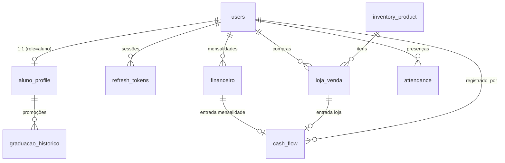
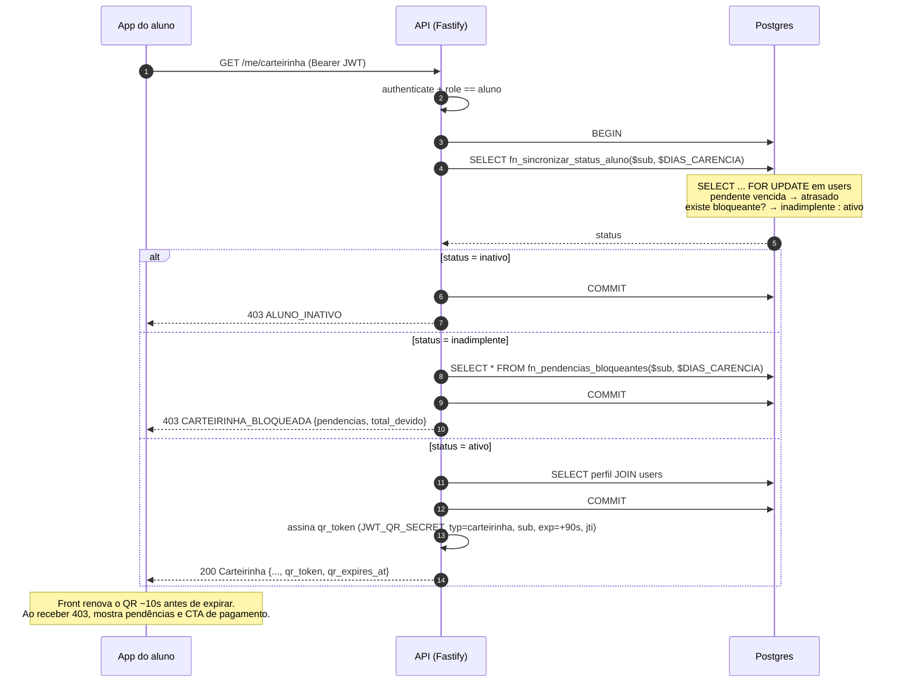

# BONSAI ERP — Arquitetura

ERP para academia de artes marciais (Boxe, Jiu-Jitsu, Muay Thai).
Base de dados: `system_contract v1.0` → [database/schema.sql](../database/schema.sql) · Tipos compartilhados → [src/types/contract.ts](../src/types/contract.ts)

---

## 1. Topologia no Railway

```
                ┌──────────────────────────── Railway Project: bonsai ───────────────────────────┐
                │                                                                                 │
 Navegador ───► │  web  (React + Vite, build estático)                                            │
 / celular      │    └─ chama ──► api  (Fastify, N réplicas, stateless) ──private net──► Postgres │
                │                   ▲  LISTEN presenca_evento  ◄───────────────────────┘          │
                │                   │                                                             │
                │  cron-diario (mesma imagem da api, comando diferente) ──────────────► Postgres  │
                └─────────────────────────────────────────────────────────────────────────────────┘
```

| Serviço | Origem | Start command | Observações |
|---|---|---|---|
| `postgres` | Template Postgres do Railway | — | Volume persistente, backups habilitados |
| `api` | `apps/api` | `node dist/server.js` | **Pre-deploy:** `node dist/migrate.js` · Healthcheck `/health` · réplicas horizontais |
| `cron-diario` | `apps/api` | `node dist/jobs/diario.js` | Cron schedule `0 6 * * *` (UTC = 03:00 BRT); processo sai ao terminar |
| `web` | este repositório | `pnpm build` → servir `dist/` | `VITE_API_URL` aponta para o domínio público da `api` |

Variáveis da `api`:

| Var | Valor |
|---|---|
| `DATABASE_URL` | `${{Postgres.DATABASE_URL}}` (rede privada, sem egress) |
| `JWT_ACCESS_SECRET` / `JWT_QR_SECRET` | segredos distintos, ≥ 32 bytes |
| `DIAS_CARENCIA` | `5` |
| `PG_POOL_MAX` | `10` por réplica (ver §9) |
| `CORS_ORIGIN` | domínio do `web` |
| `TZ_NEGOCIO` | `America/Sao_Paulo` |

## 2. Decisões arquiteturais

| Decisão | Motivo |
|---|---|
| **Fastify** (não Express) | ~2× throughput, validação/serialização por JSON Schema nativa (TypeBox), plugins oficiais `@fastify/jwt`, `@fastify/rate-limit`, `@fastify/cors`, `@fastify/helmet`. |
| **SQL direto com `pg` + Kysely** (query builder tipado) | O domínio depende de transações, `UPDATE ... WHERE estoque >= $q`, funções SQL e `LISTEN/NOTIFY`. ORM pesado esconderia isso. |
| **Migrações versionadas** (`node-pg-migrate`) rodando no *pre-deploy* | Deploy falha antes de subir código incompatível com o banco. `schema.sql` é a migração `0001`. |
| **Regras críticas no banco** (CHECK, UNIQUE parcial, triggers) | Defesa em profundidade: mesmo com bug na API não existe estoque negativo, check-in duplo, sangria como entrada, nem mensalidade lançada 2× no caixa. |
| **Dinheiro em `NUMERIC`, string no JSON** | Sem erro de ponto flutuante. Front formata com `Intl.NumberFormat`. |
| **`cash_flow` append-only** | Requisito de auditoria; correções por lançamento de estorno. |
| **Tempo real via Postgres `LISTEN/NOTIFY` + SSE** | Funciona com N réplicas sem precisar de Redis. Cada réplica escuta o canal e repassa aos seus clientes SSE. |
| **`users.status` é cache; a verdade é `financeiro`** | O status é recalculado pelo job diário **e** sob demanda (carteirinha/pagamento), então nunca fica stale por mais que uma requisição. |

## 3. Modelo de dados



Extensões ao contrato (marcadas `[EXT]` no SQL) e por quê:

- `refresh_tokens` — rotação/revogação de sessão JWT.
- `aluno_profile.numero_matricula` — número curto para a carteirinha e busca na recepção.
- `graduacao_historico` — "controle de faixas" exige histórico, não só o estado atual.
- `loja_venda.preco_unitario / desconto / metodo_pagamento / vendido_por` — preço pode mudar depois; auditoria de quem vendeu.
- `cash_flow.payment_id / sale_id / registrado_por` — rastreabilidade do lançamento até a origem; `UNIQUE` impede lançamento duplicado.
- `attendance.registrado_por / fechado_auto` — auditoria e encerramento de sessões esquecidas.
- `updated_at`, `inventory_product.ativo` — soft-delete e cache-busting.

Invariantes garantidas pelo banco:

| Invariante | Mecanismo |
|---|---|
| Profile, mensalidade, venda e presença só para `role='aluno'` | trigger `fn_assert_role_aluno` |
| Uma mensalidade por aluno por vencimento | `UNIQUE (user_id, data_vencimento)` |
| `pago` ⇔ `data_pagamento` + `metodo_pagamento` preenchidos | `ck_financeiro_coerencia` |
| Estoque nunca negativo | `CHECK (estoque_atual >= 0)` |
| `valor_total = preco_unitario × qtd − desconto` | `ck_venda_total` |
| Categoria × tipo × origem coerentes no caixa | `ck_cash_flow_categoria` |
| Mensalidade/venda lançada no caixa no máximo 1× | `UNIQUE (payment_id)`, `UNIQUE (sale_id)` |
| Uma sessão de presença aberta por aluno | índice único parcial `WHERE check_out IS NULL` |
| `total_presencas` consistente | trigger `AFTER INSERT` em `attendance` |
| Caixa imutável | trigger `BEFORE UPDATE OR DELETE` |

## 4. Autenticação e RBAC

- **Senha:** argon2id (`@node-rs/argon2`). Login com mesma resposta para e-mail inexistente e senha errada (evita enumeração).
- **Access token:** JWT HS256, 15 min, claims `{ sub, role, status }`. Enviado em `Authorization: Bearer`.
- **Refresh token:** 256 bits aleatórios em cookie `httpOnly; Secure; SameSite=Strict; Path=/api/v1/auth`, 30 dias, armazenado como SHA-256. **Rotação** a cada uso; reuso de token já rotacionado ⇒ revoga toda a família (detecção de roubo).
- **Guards Fastify** (`preHandler`):
  - `authenticate` — valida JWT, injeta `request.user`.
  - `requireRole('admin')` — 403 `SEM_PERMISSAO`.
  - `requireSelfOrAdmin(param)` — aluno só acessa `:id === sub`.
- Mudança de `status` para `inativo` revoga todos os refresh tokens do usuário.
- Rate limit: `/auth/login` 5 req/min por IP+e-mail; global 300 req/min por usuário.

Matriz de permissões:

| Recurso | Admin | Aluno |
|---|---|---|
| Alunos (CRUD, graduações) | total | só leitura do próprio perfil |
| Carteirinha | validar QR de qualquer aluno | emitir a própria |
| Presença | check-in/out de qualquer aluno, painel ao vivo | auto check-in via QR na recepção, histórico próprio |
| Mensalidades | total | ver as próprias |
| Produtos | total | listar (catálogo) |
| Vendas | registrar/listar | ver as próprias |
| Caixa / balanço | total | — |

## 5. Mapa de endpoints

Prefixo: `/api/v1`. JSON em UTF-8. Paginação: `?page=1&page_size=20` → `Paginated<T>`. Erros sempre no formato:

```json
{ "error": { "code": "ESTOQUE_INSUFICIENTE", "message": "Estoque insuficiente para Luva 12oz", "details": { "disponivel": 1 } } }
```

Status HTTP: `400` validação · `401` não autenticado/token expirado · `403` sem permissão/bloqueado · `404` · `409` conflito de estado · `422` regra de negócio · `429` rate limit.

### 5.1 Infra

| Método | Rota | Auth | Resposta |
|---|---|---|---|
| GET | `/health` | — | `200 { status: "ok", db: "ok" }` (faz `SELECT 1`) |

### 5.2 Auth

| Método | Rota | Auth | Payload | Resposta |
|---|---|---|---|---|
| POST | `/auth/login` | — | `{ email, password }` | `200 AuthResponse` + cookie refresh · `401 CREDENCIAIS_INVALIDAS` · `403 ALUNO_INATIVO` |
| POST | `/auth/refresh` | cookie | — | `200 AuthResponse` (token rotacionado) · `401` |
| POST | `/auth/logout` | cookie | — | `204` (revoga refresh) |
| GET | `/auth/me` | qualquer | — | `200 { user: User, perfil?: AlunoProfile }` |
| PATCH | `/auth/senha` | qualquer | `{ senha_atual, nova_senha }` (mín. 8) | `204` · revoga outras sessões |

> Inadimplente **consegue logar** (precisa ver as pendências e pagar); só a carteirinha é bloqueada.

### 5.3 Alunos (admin)

| Método | Rota | Payload | Resposta |
|---|---|---|---|
| GET | `/alunos` | query: `q`, `modalidade`, `status`, `faixa`, `page`, `page_size`, `sort=nome\|data_matricula` | `200 Paginated<Aluno>` |
| POST | `/alunos` | `{ nome, email, senha_inicial, modalidade, faixa, graduacao_nivel?, data_matricula?, gerar_mensalidades?: { valor, dia_vencimento, meses } }` | `201 Aluno` · `409 EMAIL_JA_CADASTRADO`. Cria `users` + `aluno_profile` (+ mensalidades) numa transação. |
| GET | `/alunos/:id` | — | `200 Aluno & { situacao_financeira: { status, pendencias: PendenciaFinanceira[] } }` |
| PATCH | `/alunos/:id` | parcial: `{ nome?, email?, modalidade? }` | `200 Aluno` |
| PATCH | `/alunos/:id/status` | `{ status: "ativo" \| "inativo" }` | `200 Aluno`. `inadimplente` **não** é settable manualmente (é derivado). Reativar chama `fn_sincronizar_status_aluno`. |
| POST | `/alunos/:id/graduacoes` | `{ faixa_nova, graduacao_nova, data_graduacao?, observacao? }` | `201 GraduacaoHistorico`. Atualiza `aluno_profile` + grava histórico na mesma transação. |
| GET | `/alunos/:id/graduacoes` | — | `200 GraduacaoHistorico[]` (admin ou o próprio aluno) |

Não há `DELETE /alunos/:id`: histórico financeiro exige soft-delete via `status=inativo`.

### 5.4 Área do aluno (`/me`)

| Método | Rota | Resposta |
|---|---|---|
| GET | `/me/perfil` | `200 Aluno` |
| GET | `/me/carteirinha` | `200 Carteirinha` · `403 CARTEIRINHA_BLOQUEADA { details: { pendencias: PendenciaFinanceira[], total_devido } }` · `403 ALUNO_INATIVO` — ver §6 |
| GET | `/me/mensalidades` | `200 Financeiro[]` (query `status?`) |
| GET | `/me/presencas` | `200 Paginated<Attendance>` (query `de`, `ate`) |
| GET | `/me/compras` | `200 Paginated<LojaVenda & { produto_nome }>` |
| GET | `/me/graduacoes` | `200 GraduacaoHistorico[]` |

### 5.5 Carteirinha (validação na recepção)

| Método | Rota | Auth | Payload | Resposta |
|---|---|---|---|---|
| POST | `/carteirinha/validar` | admin | `{ qr_token, registrar_checkin?: boolean }` | `200 { liberado: true, aluno: Aluno, attendance?: Attendance }` · `200 { liberado: false, motivo: "CARTEIRINHA_BLOQUEADA" \| "ALUNO_INATIVO", pendencias }` · `400 QR_INVALIDO` |

> Retorna `200` mesmo quando bloqueado: a requisição foi bem-sucedida; o resultado da validação é o dado. Simplifica o leitor de QR.

### 5.6 Presença

| Método | Rota | Auth | Payload | Resposta |
|---|---|---|---|---|
| POST | `/presencas/check-in` | admin | `{ user_id }` **ou** `{ qr_token }` | `201 Attendance` · `403 CARTEIRINHA_BLOQUEADA` · `409 CHECKIN_JA_ABERTO` |
| PATCH | `/presencas/:attendance_id/check-out` | admin | — | `200 Attendance` · `409 SEM_CHECKIN_ABERTO` |
| PATCH | `/presencas/check-out` | admin | `{ user_id }` (fecha a sessão aberta do aluno) | `200 Attendance` · `409 SEM_CHECKIN_ABERTO` |
| GET | `/presencas/ativas` | admin | query `modalidade?` | `200 PresenteAgora[]` (view `vw_presentes_agora`) |
| GET | `/presencas/stream` | admin | — | `text/event-stream`: eventos `PresencaEvento`; heartbeat a cada 25 s |
| GET | `/presencas` | admin | query `user_id?`, `de`, `ate`, `modalidade?` | `200 Paginated<Attendance & { nome }>` |
| GET | `/presencas/estatisticas` | admin | query `de`, `ate` | `200 { por_dia: {dia, total}[], por_modalidade, pico_horario }` |

Check-in aplica a **mesma** verificação de adimplência da carteirinha (§6). `check-out` usa `UPDATE ... WHERE check_out IS NULL RETURNING *`; zero linhas ⇒ `409`.

### 5.7 Financeiro (admin)

| Método | Rota | Payload | Resposta |
|---|---|---|---|
| GET | `/mensalidades` | query `user_id?`, `status?`, `vencimento_de`, `vencimento_ate` | `200 Paginated<Financeiro & { nome }>` |
| POST | `/mensalidades` | `{ user_id, valor, data_vencimento }` | `201 Financeiro` · `409 MENSALIDADE_DUPLICADA` |
| POST | `/mensalidades/lote` | `{ competencia: "2026-12", dia_vencimento: 10, valor_padrao, modalidade?, valores_por_aluno?: {user_id, valor}[] }` | `201 { criadas, ignoradas }` — `INSERT ... ON CONFLICT (user_id, data_vencimento) DO NOTHING` (idempotente) para alunos `ativo`/`inadimplente` |
| PATCH | `/mensalidades/:payment_id` | `{ valor?, data_vencimento? }` (só se não paga) | `200 Financeiro` · `409 MENSALIDADE_JA_PAGA` |
| PATCH | `/mensalidades/:payment_id/pagar` | `{ metodo_pagamento, data_pagamento? }` | `200 { mensalidade: Financeiro, lancamento: CashFlow, status_aluno: UserStatus }` · `409 MENSALIDADE_JA_PAGA` — ver §7.2 |
| DELETE | `/mensalidades/:payment_id` | — | `204` só se `status <> 'pago'` (lançada por engano) |
| GET | `/financeiro/inadimplentes` | — | `200 { user_id, nome, total_devido, mais_antiga, dias_atraso }[]` |
| GET | `/financeiro/resumo` | query `competencia` | `200 { previsto, recebido, em_aberto, atrasado, taxa_inadimplencia }` |

### 5.8 Produtos / Inventário

| Método | Rota | Auth | Payload | Resposta |
|---|---|---|---|---|
| GET | `/produtos` | qualquer | query `categoria?`, `q?`, `incluir_inativos?` (admin) | `200 InventoryProduct[]` |
| GET | `/produtos/:id` | qualquer | — | `200 InventoryProduct` |
| POST | `/produtos` | admin | `{ nome, preco, estoque_atual, categoria }` | `201 InventoryProduct` |
| PATCH | `/produtos/:id` | admin | `{ nome?, preco?, categoria?, ativo? }` | `200 InventoryProduct` |
| PATCH | `/produtos/:id/estoque` | admin | `{ operacao: "entrada" \| "ajuste", quantidade, motivo }` | `200 InventoryProduct` · `422` se ajuste deixa negativo |
| DELETE | `/produtos/:id` | admin | — | `204` (soft: `ativo=false`) |

### 5.9 Vendas (admin)

| Método | Rota | Payload | Resposta |
|---|---|---|---|
| POST | `/vendas` | `{ user_id, metodo_pagamento, itens: [{ product_id, quantidade, desconto? }] }` + header `Idempotency-Key` | `201 { vendas: LojaVenda[], total: Decimal, lancamentos: CashFlow[] }` · `409 ESTOQUE_INSUFICIENTE` · `422 PRODUTO_INATIVO` — ver §7.1 |
| GET | `/vendas` | query `user_id?`, `product_id?`, `de`, `ate` | `200 Paginated<LojaVenda & { aluno_nome, produto_nome }>` |
| GET | `/vendas/:sale_id` | — | `200 LojaVenda` |

### 5.10 Fluxo de caixa (admin)

| Método | Rota | Payload | Resposta |
|---|---|---|---|
| GET | `/caixa/lancamentos` | query `de`, `ate`, `tipo?`, `categoria?` | `200 Paginated<CashFlow>` |
| POST | `/caixa/sangrias` | `{ valor, motivo }` | `201 CashFlow` (`tipo=saida`, `categoria=sangria`) |
| POST | `/caixa/lancamentos` | `{ tipo, valor, motivo }` | `201 CashFlow` (`categoria=outros` — despesas avulsas e estornos) |
| GET | `/caixa/balanco` | query `dia=YYYY-MM-DD` (padrão hoje) | `200 BalancoDiario` (`fn_balanco_diario`) |
| GET | `/caixa/balanco/periodo` | query `de`, `ate` | `200 { dias: BalancoDiario[], consolidado: BalancoDiario }` |

`mensalidade` e `loja` **não** podem ser criadas por estas rotas — nascem apenas dos fluxos de pagamento/venda.

### 5.11 Dashboard (admin)

| Método | Rota | Resposta |
|---|---|---|
| GET | `/dashboard` | `200 { alunos_ativos, inadimplentes, presentes_agora, receita_mes, saldo_hoje, estoque_baixo: InventoryProduct[] }` |

## 6. Fluxo de validação da carteirinha

Princípio: **nunca confiar só no flag `users.status`**. Ele é atualizado pelo job diário, mas entre execuções uma mensalidade pode vencer ou ser paga. Por isso a emissão e a validação recalculam a situação em tempo real dentro de uma transação, corrigindo o flag de passagem (*self-healing*).

Definições (com `DIAS_CARENCIA = 5`):

- **pendente** → ainda não venceu.
- **atrasado** → `data_vencimento < hoje` e não pago. *Ainda não bloqueia.*
- **bloqueante** → não pago e `data_vencimento + carência < hoje`. **Bloqueia.**



Validação na recepção (`POST /carteirinha/validar` ou `POST /presencas/check-in` com `qr_token`):

1. Verifica assinatura com `JWT_QR_SECRET` (segredo **diferente** do access token — um não serve como o outro), `typ === 'carteirinha'` e `exp`. Falha ⇒ `QR_INVALIDO`.
2. **Revalida** com `fn_sincronizar_status_aluno(sub)`: o QR pode ter sido emitido antes de um vencimento, ou o aluno pode ter sido inativado nos últimos 90 s. A expiração curta limita a janela de print/compartilhamento do QR.
3. `ativo` ⇒ `liberado: true` e, se `registrar_checkin`, `INSERT INTO attendance` (o índice único parcial converte check-in duplo em `409 CHECKIN_JA_ABERTO`).
4. Caso contrário ⇒ `liberado: false` com motivo e pendências, para a recepção cobrar no balcão.

Fontes de atualização do status (todas usam a mesma regra SQL, então nunca divergem):

| Gatilho | Ação |
|---|---|
| Job diário 03:00 BRT | `fn_processar_inadimplencia(carência)` — set-based para todos os alunos |
| Pagamento de mensalidade | `fn_sincronizar_status_aluno` na mesma transação ⇒ desbloqueio **imediato** |
| Emissão/validação de carteirinha e check-in | `fn_sincronizar_status_aluno` (self-healing) |
| Admin reativa aluno inativo | `fn_sincronizar_status_aluno` decide entre `ativo`/`inadimplente` |

O claim `status` no access token é só para UI (ex.: banner "pendência financeira"). **Decisões de acesso nunca usam o claim**, sempre o banco.

## 7. Fluxos transacionais

### 7.1 Venda (`POST /vendas`)

```sql
BEGIN;
-- para cada item, em ordem de product_id (evita deadlock entre vendas simultâneas):
UPDATE inventory_product
   SET estoque_atual = estoque_atual - $qtd
 WHERE product_id = $pid AND ativo AND estoque_atual >= $qtd
RETURNING preco, nome;
-- 0 linhas ⇒ ROLLBACK + 409 ESTOQUE_INSUFICIENTE (ou 422 PRODUTO_INATIVO)
INSERT INTO loja_venda (..., preco_unitario = preco, valor_total = preco*qtd - desconto) RETURNING sale_id;
INSERT INTO cash_flow (tipo='entrada', categoria='loja', sale_id, valor=valor_total, motivo='Venda: '||nome, registrado_por=$admin);
COMMIT;
```

O `UPDATE` condicional é atômico: duas vendas concorrentes do último item nunca passam ambas (sem `SELECT ... FOR UPDATE` separado). `Idempotency-Key` (guardada 24 h) evita venda dupla por clique duplo ou retry de rede.

### 7.2 Pagamento de mensalidade (`PATCH /mensalidades/:id/pagar`)

```sql
BEGIN;
UPDATE financeiro
   SET status='pago', data_pagamento=coalesce($data, fn_hoje_sp()), metodo_pagamento=$metodo
 WHERE payment_id=$id AND status <> 'pago'
RETURNING *;                         -- 0 linhas ⇒ 409 MENSALIDADE_JA_PAGA
INSERT INTO cash_flow (tipo='entrada', categoria='mensalidade', payment_id=$id, valor, motivo, registrado_por);
SELECT fn_sincronizar_status_aluno(user_id, $carencia);   -- desbloqueia na hora
COMMIT;
```

### 7.3 Sangria (`POST /caixa/sangrias`)
`INSERT` simples com `tipo='saida', categoria='sangria'`. O `CHECK` do banco recusa qualquer outra combinação. Estorno de qualquer lançamento = novo lançamento `outros` no sentido oposto, com `motivo` referenciando o `transaction_id` original.

### 7.4 Check-in/out
Ver §5.6 e §6. Toda mudança dispara `pg_notify('presenca_evento', ...)` via trigger; o `LISTEN` em cada réplica da API repassa aos clientes SSE conectados naquela réplica.

## 8. Jobs agendados (`cron-diario`)

Executado 1×/dia; idempotente (rodar 2× não causa efeito diferente).

1. `SELECT * FROM fn_processar_inadimplencia($DIAS_CARENCIA)` → log `{ mensalidades_atrasadas, alunos_bloqueados, alunos_regularizados }`.
2. `SELECT fn_fechar_presencas_abandonadas(4)` → fecha sessões abertas há > 4 h.
3. `DELETE FROM refresh_tokens WHERE expires_at < now() - interval '7 days'`.
4. (Dia 25) gerar mensalidades da competência seguinte via a mesma lógica de `/mensalidades/lote`.

Usar `pg_try_advisory_lock(<id>)` no início para garantir execução única caso o cron dispare sobreposto.

## 9. Escalabilidade no Railway

- **API stateless**: nenhum estado em memória além das conexões SSE; escala horizontal por réplicas. Sessão = JWT; tempo real = Postgres NOTIFY.
- **Pool de conexões**: `réplicas × PG_POOL_MAX + 1 (LISTEN por réplica) + cron` deve ficar abaixo do `max_connections` do plano (padrão 100). Ex.: 4 réplicas × 10 + 4 + 2 = 46. Acima disso, colocar PgBouncer (template Railway) em *transaction mode* — e manter a conexão `LISTEN` direta no Postgres, pois LISTEN não funciona via PgBouncer em transaction mode.
- **Rede privada**: `DATABASE_URL` interno (`*.railway.internal`) — menor latência e sem custo de egress.
- **Índices** cobrem as consultas quentes: presentes agora (parcial `check_out IS NULL`), mensalidades em aberto (parcial `status <> 'pago'`), balanço por intervalo de `data`, histórico por `(user_id, check_in DESC)`.
- **Timezone**: servidor em UTC; toda noção de "dia" passa por `fn_hoje_sp()` / `AT TIME ZONE 'America/Sao_Paulo'`.
- **Graceful shutdown**: tratar `SIGTERM` (Railway envia em cada deploy) — `fastify.close()`, encerrar SSE com evento `reconnect`, drenar pool.
- **Observabilidade**: logs JSON do Fastify (pino) com `request_id`; Railway agrega por serviço. `/health` checa o banco.
- **Segurança**: `@fastify/helmet`, CORS restrito ao domínio do `web`, rate-limit, validação de todo payload por schema (rejeita campos extras), queries sempre parametrizadas.
- **Crescimento futuro** (sem refatorar o modelo): multi-unidade = coluna `academia_id` + RLS; aluno em várias modalidades = PK de `aluno_profile` vira `(user_id, modalidade)`; gateway de pagamento (Pix automático) = webhook que chama o mesmo fluxo §7.2.

## 10. Estrutura sugerida do back-end

```
apps/api/
  src/
    server.ts              # bootstrap Fastify, plugins, graceful shutdown
    migrate.ts             # roda migrations (pre-deploy)
    config.ts              # env validada com zod/typebox — falha no boot se faltar var
    db/
      pool.ts              # pg Pool + Kysely
      listener.ts          # conexão dedicada LISTEN presenca_evento → EventEmitter
      migrations/0001_init.sql   # = database/schema.sql
    plugins/
      auth.ts              # @fastify/jwt, authenticate, requireRole, requireSelfOrAdmin
      errors.ts            # mapeia erros PG (23505, 23514, P0002) → ApiError
      idempotency.ts
    modules/
      auth/  alunos/  carteirinha/  presencas/  financeiro/  produtos/  vendas/  caixa/  dashboard/
        *.routes.ts        # rotas + JSON schema
        *.service.ts       # regras e transações
        *.repo.ts          # SQL
    jobs/diario.ts
  test/                    # Vitest + Testcontainers (Postgres real)
```

Mapeamento de erros do Postgres no plugin `errors.ts`: `23505` em `uq_users_email` → `EMAIL_JA_CADASTRADO`; em `uq_attendance_sessao_aberta` → `CHECKIN_JA_ABERTO`; em `uq_financeiro_competencia` → `MENSALIDADE_DUPLICADA`; `23514` em `ck_product_estoque` → `ESTOQUE_INSUFICIENTE`.
